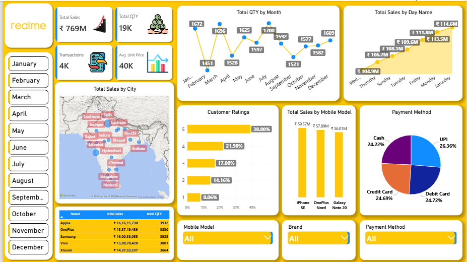

# Mobile Sales Analysis Dashboard | Power BI

An interactive Power BI dashboard built to explore mobile sales performance, product trends, customer ratings, and payment preferences.

## Project Overview

This project analyzes mobile sales data to understand business performance across brands, mobile models, cities, months, and payment methods.

The report combines key performance indicators and interactive visualizations to provide a consolidated view of mobile sales.

## Dashboard Preview

## Dataset Overview

The dataset contains 3,835 transactions recorded between October 2021 and October 2024.

| Dataset Details | Value |
|---|---:|
| Total Records | 3,835 |
| Total Columns | 14 |
| Unique Transactions | 3,835 |
| Mobile Brands | 5 |
| Mobile Models | 15 |
| Cities | 19 |
| Payment Methods | 4 |

## Key Performance Indicators

| KPI | Value |
|---|---:|
| Total Sales | ₹769.20M |
| Total Quantity Sold | 19,150 |
| Total Transactions | 3,835 |
| Average Unit Price | ₹40,114 |

## Dashboard Analysis

### 1. Sales Performance
- Monthly quantity sold trends
- Sales by day of the week
- City-wise sales distribution using map visualization

### 2. Product Performance
- Sales comparison across mobile models
- Brand-wise sales and quantity comparison
- Top-performing mobile models

### 3. Customer Analysis
- Customer rating distribution (1–5)
- Customer ratings analysis
- Geographic sales distribution

### 4. Payment Analysis
- Transaction distribution by payment method
- UPI, debit card, credit card, and cash comparison

## Key Business Insights

- Total sales reached approximately ₹769.20 million.
- July recorded the highest monthly quantity sold, with 1,700 units.
- Saturday recorded the highest sales among weekdays, at approximately ₹114.62 million.
- iPhone SE was the top-performing mobile model by sales, at approximately ₹59.57 million.
- 5-star ratings accounted for 38.80% of customer ratings.
- UPI accounted for 26.36% of transactions.

## Interactive Features

The dashboard includes slicers for:
- Month
- Mobile Model
- Brand
- Payment Method

These filters allow users to explore different aspects of sales performance interactively.

## Tools & Technologies

- Microsoft Power BI
- Microsoft Excel
- DAX (Data Analysis Expressions)
- Data Visualization
- Interactive Slicers
- Map Visualization

## Files Included

| File | Description |
|---|---|
| `Mobile_Sales_Analysis_Dashboard.pbix` | Complete Power BI report |
| `Mobile_Sales_Data.xlsx` | Source dataset |
| `dashboard-preview.png` | Dashboard screenshot |

## Project Outcome

This project provided practical experience in analyzing sales data, working with Power BI visualizations, creating KPI-based reports, and presenting business insights through an interactive dashboard.
